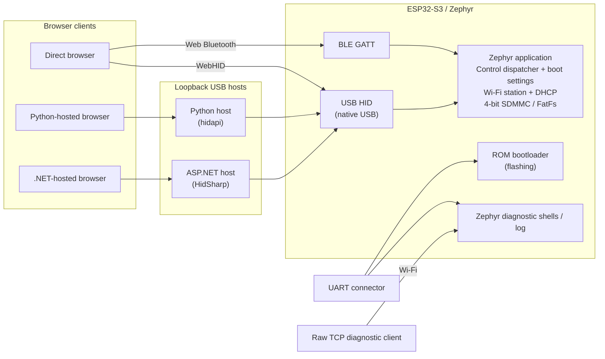

# Firmware architecture

[Documentation](../README.md) / Development / Architecture

USB HID and BLE feed the same control dispatcher. Slow radio and storage operations run outside the management
loop's application lock, including settings flash writes. This page explains the service boundaries
and concurrency rules. For source layout and tests, use [firmware development](firmware.md).

- [Service responsibilities](#service-responsibilities)
- [Platform integration and build-time composition](#platform-integration)
- [Startup, locking, and failure handling](#lifecycle-and-failure-handling)

USB HID and BLE share ZephyrForge report payloads and Control semantics, defined by the
[USB HID](../reference/usb-hid.md) and [Bluetooth LE](../reference/bluetooth-le.md) specifications.

The diagram shows the full ESP32-S3 configuration. Board and feature selections can remove links and services;
the [board guide](../hardware/README.md) lists available connections, and the platform table below identifies
their driver integration.

## Service responsibilities

| Layer | Responsibility |
| --- | --- |
| Application lifecycle | Boot order, application synchronization, event wakeups and bounded service polling |
| Board integration | UID/serial, reset cause, hardware snapshots and delayed reboot |
| Control dispatcher | Command validation and execution shared by USB and BLE, with separate result slots |
| Management report composition | Gather hardware/service snapshots and merge saved configuration policy |
| Protocol encoding | Shared payload types and stateless wire encoding; no live service reads |
| Credential staging | Expiring candidate settings and their test/commit state |
| USB HID and BLE | Transport framing, read snapshots, publication/polling, and connection lifecycle |
| BLE authentication | Session unlock and per-command HMAC proofs |
| Wi-Fi | Saved-network joins, candidate tests and scans |
| Diagnostic shells | Native UART and raw TCP inspection without application mutations ([console](../guides/console.md)) |
| Telemetry | CPU load, temperature and clock sampling |
| Storage | Runtime SD detection, disk/FAT lifecycle and exclusive ownership for USB or media jobs |
| Benchmark | Request/status ownership, portable transfer/verification engine and FatFs file adapter |
| Boot settings | One CRC-checked next-boot record for CPU clock, radio switches and credentials ([settings](../reference/boot-settings.md)) |

Python and .NET own USB HID connections and serve the same dashboard through a loopback HTTP API. Direct owns
its browser frontend and talks through WebHID/Web Bluetooth. It does not import the shared dashboard.
See [host development](host-tools.md) for these boundaries.

## Platform integration

| Integration | ESP32-S3 | ESP32-C6 | Pico family |
| --- | --- | --- | --- |
| Application core | PROCPU only | High-performance core | Core 0 only |
| USB device stack | Zephyr `device_next`, native OTG | No native HID/MSC | Zephyr `device_next`, native device controller |
| Wi-Fi | Espressif network management and DHCP | Espressif network management and DHCP | AIROC/WHD and DHCP on W boards; none on non-W boards |
| Bluetooth | Zephyr host and SoC controller | Zephyr host and SoC controller | Not included |

Storage uses Zephyr disk access and FatFs over the selected native or SPI host. The Pico native host implements
the Zephyr SDHC API on PIO. The [SD reference](../reference/sd-storage.md) covers driver configuration and limits.
Settings use a fixed CRC-checked record rather than Zephyr settings/NVS;
the [settings reference](../reference/boot-settings.md) defines its lifecycle and durability.

### Build-time composition

Board selection defines hardware identity and wiring; feature selection defines which services are linked.
Shared report encoding and control policy are independent of USB and BLE transport implementations.
Kconfig owns target module selection; portable build definitions exercise the same feature gates in unit tests.
Wi-Fi and BLE expose type-safe inline stubs when their Kconfig modules are omitted. Advertised radio support follows
the built services rather than the physical board's possible radios. Runtime radio switches cannot restore omitted
modules.
Storage policy remains separate from worker/admission and disk/FAT adapters. The USB transport implements the
storage export contract; export can be omitted without removing FAT mounting. Benchmark file operations belong
to the benchmark and run only after storage grants exclusive media ownership.
Use [firmware build options](firmware-build.md#optional-modules) for selection and dependencies.

## Lifecycle and failure handling

### Boot

Startup loads the [settings record](../reference/boot-settings.md) before consumers start, then applies the clock
and initializes the services. Card detection and mounting start after the management transports are initialized.

A mount failure is logged but does not stop USB or the radios. Report 10 can show an initialized card without a
mounted filesystem; it does not carry the mount error code. Boot logs include settings-load source and elapsed
time, and initial SD setup/mount duration. No card self-test or file write runs at boot.

### Threads and locking

USB callbacks run in the USB stack thread and BLE callbacks in the Bluetooth thread. Both call the same control
dispatcher. After boot initialization, shared control, settings, staging and BLE session state use the recursive
application mutex. Wi-Fi owns a separate mutex; callers do not access its state directly.

When locks must be nested, acquire the application mutex before a service-state mutex. The storage worker may
acquire the media mutex before the storage-snapshot mutex; the snapshot mutex is never held while waiting for
media ownership. Service callbacks do not acquire the application mutex while holding a service-state mutex.
Keep this order when adding cross-service calls.

- **Settings saves** are owned by the settings service. It prepares the record under the application mutex, then
  erases, writes, and verifies flash on a dedicated low-priority work queue without it. USB reports Pending until
  completion and holds the final result until read. The BLE write response acknowledges admission; clients poll its
  result until terminal. Wi-Fi events wake the main loop, which services the earliest module deadline and uses a
  one-second maximum idle wait. This is not a response-time guarantee. The
  [flash-operation timing log](../reference/boot-settings.md#saving) excludes lock wait and full callback latency;
  save responsiveness and contention have not been hardware-qualified.
- **Wi-Fi events** are queued and wake the main loop; module state is guarded by its own mutex. Connect, disconnect,
  and scan requests run on a dedicated queue outside that mutex.
- **Storage** runs in a worker outside the application lock. Native MSC block I/O runs in its own USB class thread.
  Flash, Wi-Fi driver and filesystem operations may block, so their dedicated workers are not merged into the
  latency-sensitive system work queue. Stack budgets are not reduced until high-water measurements cover supported
  targets and worst-case operations; native simulation cannot establish MCU stack requirements.

### Command completion and recovery

Reboots are scheduled about one second after the reply so the host can read the result. A running settings write, then
an accepted reboot or save, blocks further reboot/save and storage-control requests until reset; diagnostic reads
remain available.
Failed reset scheduling leaves normal admission available. Busy or USB-owned storage blocks reboot/settings-save.
An accepted storage request is not proof that the ownership transition has finished; see
[SD ownership](../reference/sd-storage.md#usb-drive-handoff) for completion and recovery rules.

Wi-Fi joins, scans and recovery have separate completion states. Their user-visible timing and recovery behavior
belong to the [wireless guide](../guides/wireless.md) and
[USB control contract](../reference/usb-hid.md#wireless-command-rules).

Hosts reject reports outside the wire contracts and never retry a command whose outcome is uncertain. They block
further writes until the user confirms a re-sync, so the board can be checked first.
