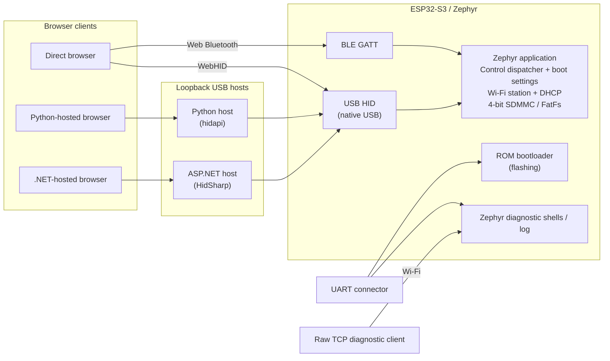

# Architecture

USB HID and BLE feed the same control dispatcher. Slow radio and storage operations run outside the management
loop's application lock; settings saves are a synchronous exception. This page explains the service boundaries
and concurrency rules. For source layout and tests, use [firmware development](../development/firmware.md).

USB HID and BLE share ZephyrForge report payloads and Control semantics, defined by the
[USB HID](usb-hid.md) and [Bluetooth LE](bluetooth.md) specifications.

The diagram shows the ESP32-S3. The Raspberry Pi Pico images keep the USB HID path, control dispatcher, SD storage
and UART shell, but have no BLE or TCP shell; W variants also include Wi-Fi. They are flashed as UF2 images through
the MCU's USB bootloader. The ESP32-C6 has no native USB HID or MSC; Direct uses its authenticated BLE service only
when a Control key is saved through [physical commissioning](../guides/boards/esp32c6-commissioning.md).
Its SD-enabled image uses SPI2, not native SDMMC. See the
[C6 hardware guide](../guides/hardware.md#esp32-c6-devkitc-1-n8).

## Service responsibilities

| Layer | Responsibility |
| --- | --- |
| Application lifecycle | Boot order and periodic servicing of control, Wi-Fi, telemetry, and USB |
| Board integration | Shared state locking, UID/serial, reset cause, board facts and delayed reboot |
| Control dispatcher | Command validation and execution shared by USB and BLE, with separate result slots |
| Report encoding | Shared identity, configuration, telemetry, storage, and wireless payloads |
| Wireless staging and authentication | Expiring credential candidates, BLE session unlock and per-command HMAC proofs |
| USB HID and BLE | Transport framing, read snapshots, publication/polling, and connection lifecycle |
| Wi-Fi | Saved-network joins, candidate tests and scans |
| Diagnostic shells | Native UART and raw TCP inspection without application mutations ([console](../guides/console.md)) |
| Telemetry and storage | CPU load, temperature, and clock; runtime SD detection, FAT mount, and exclusive USB handoff |
| Boot settings | One CRC-checked next-boot record for CPU clock, radio switches and credentials ([settings](settings.md)) |

Python and .NET own USB HID connections and serve the same dashboard through a loopback HTTP API. Direct owns
its browser frontend and talks through WebHID/Web Bluetooth. It does not import the shared dashboard.
See [host development](../development/host-tools.md) for these boundaries.

## Platform integration

| Integration | ESP32-S3 | ESP32-C6 | Pico family |
| --- | --- | --- | --- |
| Application core | PROCPU only | High-performance core | Core 0 only |
| USB device stack | Zephyr `device_next`, native OTG | No native HID/MSC | Zephyr `device_next`, native device controller |
| Wi-Fi | Espressif network management and DHCP | Espressif network management and DHCP | AIROC/WHD and DHCP on W boards; none on non-W boards |
| Bluetooth | Zephyr host and SoC controller | Zephyr host and SoC controller | Not included |

Storage uses Zephyr disk access and FatFs over the selected native or SPI host. The Pico native host implements
the Zephyr SDHC API on PIO. The [SD reference](sdcard.md) covers driver configuration and limits.
Settings use a fixed CRC-checked record rather than Zephyr settings/NVS; the [settings reference](settings.md)
defines its lifecycle and durability.

## Lifecycle and failure handling

### Boot

Startup loads the [settings record](settings.md), applies the CPU clock profile, and initializes detected SD storage.
It then starts Wi-Fi, joining the saved network when enabled, and BLE when enabled with a saved Control key.
USB starts last on boards that support it.

A mount failure is logged but does not stop USB or the radios. Report 10 can show an initialized card without a
mounted filesystem; it does not carry the mount error code. Boot logs include settings-load source and elapsed
time, and initial SD setup/mount duration. No card self-test or file write runs at boot.

### Threads and locking

USB callbacks run in the USB stack thread and BLE callbacks in the Bluetooth thread. Both call the same control
dispatcher. After boot initialization, every access to settings, staging, and wireless state holds one application
mutex.

- **Settings saves** erase, write, and verify flash synchronously in the callback while holding the mutex.
  The nominal 20 ms main-loop period is not a response-time guarantee. The
  [flash-operation timing log](settings.md#saving) excludes lock wait and full callback latency;
  save responsiveness and contention have not been hardware-qualified.
- **Wi-Fi events** are queued and applied by the main loop. Connect, disconnect, and scan requests run outside
  the lock.
- **Storage** runs in a worker outside the application lock. Native MSC block I/O runs in its own USB class thread.

### Command completion and recovery

Reboots are scheduled about one second after the reply so the host can read the result. An accepted reboot or save
blocks further reboot/save and storage-control requests until reset; diagnostic reads remain available.
Failed reset scheduling leaves normal admission available. Busy or USB-owned storage blocks reboot/settings-save.
An accepted storage request is not proof that the ownership transition has finished; see
[SD ownership](sdcard.md#usb-drive-handoff) for completion and recovery rules.

#### Wi-Fi lifecycle

Wi-Fi joins time out after 30 seconds. Saved-network retries start after 5 seconds and double up to 60 seconds.
Scans time out after 10 seconds on ESP32-S3 and 15 seconds on W boards. A test reports success only after DHCP
provides an IPv4 address.

After a canceled join, wait for the board to report disconnection before starting another. A scan that times out
but never completes remains active; reboot before starting another scan. If the driver reports an interface-down
state, it must finish cleanup before another join can start.

Hosts reject reports outside the wire contracts and never retry a command whose outcome is uncertain. They block
further writes until the user confirms a re-sync, so the board can be checked first.

## Downstream development

Add product work in separate services rather than blocking the main loop or holding the application lock.
Keep GPIO choices in board overlays, keep protocol changes versioned, and update the authoritative
references and all three host paths together. Platform-dependent work must respect the configured single-core
application and existing resource ownership.
