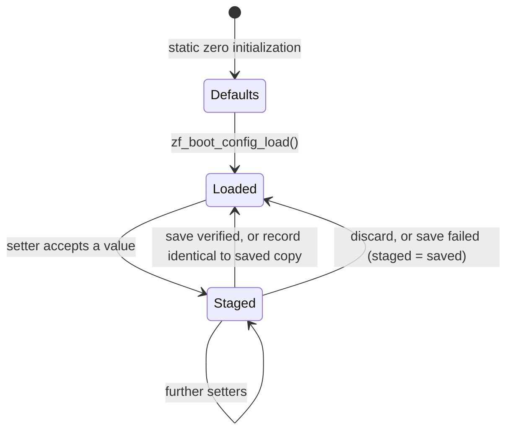

# Boot settings specification

For an application change, read [RAM Copy Lifecycle](#ram-copy-lifecycle) and [Using the API](#using-the-api).
For tooling or image compatibility, use [record format](#record-format) and [flash reservation](#flash-reservation).

## Scope and conventions

The device keeps a small set of **next-boot settings** in one flash record: the CPU clock profile, the Wi-Fi and BLE
switches, and the private wireless credentials. They are changed at runtime, saved as one verified record, and take
effect only at the next boot. The wire encoding is HID Feature report `2` and Feature report `20` opcode `5` in the
[USB HID specification](usb-hid.md) and the [Bluetooth LE specification](bluetooth.md).
For provisioning steps, use the [wireless guide](../guides/wireless.md).

All record offsets and sizes are in bytes. Multibyte integers are little-endian.
SSID and Control-key fields are raw bytes; the passphrase is a NUL-terminated byte string.
The persistent record version is independent of HID/BLE payload versions and firmware semantic version.

The key words **MUST**, **MUST NOT**, **SHOULD**, **SHOULD NOT**, and **MAY** are to be interpreted as described
in BCP 14 (RFC 2119, RFC 8174) when, and only when, they appear in all capitals.

| Setting | Values | Default | Applied when |
| --- | --- | --- | --- |
| CPU clock (`zf_sysclk_profile_t`) | Default (S3 240 MHz, C6 160 MHz), 80, 160 or 240 MHz on S3; at most 160 MHz on C6 | Default | Early boot, before storage and radios |
| Wi-Fi / Bluetooth switches | Enabled or disabled | Enabled | Radio initialization at boot |
| Wi-Fi SSID, passphrase and auth state | See [record format](#record-format) | None | Saved-network connect at boot |
| Control key | 32 raw bytes, see [record format](#record-format) | None | [BLE control](bluetooth.md) authentication; BLE does not start without a key |

Wi-Fi and BLE stay **enabled by default**: an erased, missing or invalid record enables both radios.

The selectable clock values apply to ESP32-S3 and ESP32-C6; C6 rejects profiles above 160 MHz.
The Raspberry Pi Pico images load the record at boot but cannot save it: Report `1` advertises no settings save,
so opcode `5` returns Unsupported (error `4`). Those images
keep the devicetree build clock. W variants apply the saved Wi-Fi switch and credentials, masking out BLE;
non-W variants start no radios. W candidate credentials remain RAM-only.

## Architecture

During firmware operation, all settings pass through the settings service's RAM state. Writers only
stage values in RAM; one save call commits the complete record to flash. Boot initialization uses the boot
snapshot. Saving does not reconfigure the running hardware; host save commands schedule a subsequent reboot.

- **One record, one CRC.** Clock profile, switches and credentials are validated as one unit; no partial record
  is applied. This is not a power-loss-atomic transaction.
- **Next boot only.** The clock is set and the radios start once at boot, so setters change only RAM and saved
  values apply after reboot. Feature report `2` reports the saved values, not the ones running now.
- **One lock.** `zf_boot_config_load()` runs during early boot, before USB and BLE start. Afterwards every read
  and save MUST be serialized under the application mutex (`zf_lock()`), whether the request
  arrived over USB HID or BLE. This is not a general thread-safe settings API.
- **Invalid settings do not stop boot.** Missing, unreadable, or invalid records load complete defaults.
- **No generic store.** The fixed record is read directly and written as one padded page through the
  flash API. Zephyr's settings/NVS subsystems are not used. Record validation and flash access are internal
  responsibilities of the settings service.

## RAM copy lifecycle

The module holds three copies: **staged** (what setters change), **saved** (the last record loaded or confirmed) and
**boot** (what was loaded for this boot). The boot snapshot is intended policy, not proof that clock or radio
initialization succeeded. Boot loads the record before settings consumers start. Later callers MUST hold the
application lock.

A setter that rejects an out-of-range value returns `false` without changing the copy.

### Transactional staging

Each writer MUST validate and stage every requested value, then save once. Rejected staging MUST be discarded;
a failed save restores the last confirmed RAM values:

- **Opcode `5`:** stages the clock and radio switches and, when the commit flag is set, the wireless values staged
  by opcodes `6`-`8` (SSID, passphrase with auth state `0`, try WPA2, and Control key).
  Flash-save failure calls `zf_boot_config_discard()`. See [host dashboard settings](#host-dashboard-settings).
- Opcodes `6`-`8` hold separate wireless candidates, not settings-service state, until opcode `5`
  commits them. Opcode `9` tests staged credentials without saving them.

A failed save does not prove that flash is unchanged: an erase can complete before programming fails. The staged
copy then returns to the last confirmed values, while the next boot loads whatever flash actually contains
(complete defaults if the record is damaged). If flash verification succeeds but scheduling reboot fails,
opcode `5` reports Failed even though settings were persisted. Hosts MUST reconcile saved state rather than
assuming every failed command left flash unchanged. Failed commands do not schedule an automatic retry or reboot.

## Boot sequence

Boot reads and validates the record before any settings consumer starts. It then applies the clock profile,
initializes storage, starts the selected radios, and enables USB where supported.
Every later consumer reads the same RAM copies; see [architecture](architecture.md#lifecycle-and-failure-handling)
for the full service lifecycle.

### Loading and validation

`zf_boot_config_load()` reads 148 bytes from the partition start. Read failure loads defaults with source
`READ_ERROR`; an invalid or erased record loads defaults with source `DEFAULTS`; a valid record uses source `SAVED`.
Defaults include no credentials.

A record is valid only if all of these hold: magic `EFCF`, version `1`, size `148`, matching CRC-32, clock profile
`0`–`3`, a zero byte 9, no unknown service bits, Wi-Fi auth state `0`–`3`, SSID length at most 32 with zero padding,
an empty or 8–63 byte NUL-terminated passphrase with zero padding, zero reserved bits, and a zero key whenever the
key-present flag is clear. Fields MUST NOT be applied partially. Loading MUST NOT write flash. An erased partition
(`0xFF`) loads defaults. `zf_boot_config_source()` reports which case occurred.

## Saving

`zf_boot_config_save()` is the only runtime firmware settings writer. Initial physical C6 commissioning writes a
key-only record before application boot; the procedure is in the
[first-key commissioning guide](../guides/boards/esp32c6-commissioning.md).

For a changed record, save encodes the fields and CRC, erases the first 4 KiB sector, writes one 256-byte page
padded with `0xFF`, and reads it back. Success updates the saved RAM copy and returns zero. Failure restores staged
RAM from the last confirmed copy and returns a negative errno; it does not restore an erased flash sector.

The Zephyr ESP32 flash driver suspends the cache and serializes SPI-flash access while erasing and programming, so
other threads and radio interrupts may be delayed briefly. Saves are rare user actions and execute synchronously
in the USB or Bluetooth callback thread under the application mutex, not exclusively in the main thread.
Buffers holding the encoded record and padded page are cleared after use.

Changed saves log `Settings flash operation: N ms, result E` on the UART console. The duration spans erase,
programming, verification and flash-area closure; `E` is zero on success or a negative errno. It excludes mutex
acquisition, flash-area opening and transport response delivery. Unchanged saves and failures to open the flash area
do not emit this timing entry. This is observability, not a response-time guarantee; measure complete host response
and concurrent read delay using the [qualification procedure](../validation/firmware-qualification.md).

If staged settings equal the last confirmed RAM copy, save returns success without reading or writing flash.
This does not repair an erased/invalid record or detect external changes to flash. The source indicator remains
unchanged for such a no-op; a verified write sets it to SAVED.
After a changed save, success requires a successful erase, write, readback and byte-for-byte match of the
148-byte record. The implementation reads the full 256-byte page but compares only the record bytes.

## Record format

Little-endian, 148 bytes, padded with `0xFF` to one 256-byte page at the start of the settings sector.
Encoders MUST produce the fixed layout below; decoders MUST reject an unsupported version, invalid field,
incorrect size or CRC mismatch and load complete defaults.

| Offset | Size | Content |
| --- | --- | --- |
| 0 | 4 | magic `EFCF` |
| 4 | 2 | format version (`1`) |
| 6 | 2 | record size (`148`) |
| 8 | 1 | CPU clock profile (`0` Default, `1` 80 MHz, `2` 160 MHz, `3` 240 MHz) |
| 9 | 1 | Reserved, zero; no saved SD-card speed profile |
| 10 | 1 | Disabled services: bit 0 Wi-Fi, bit 1 Bluetooth; other bits invalid |
| 11 | 1 | Wi-Fi authentication state (`0` try WPA2, `1` try WPA3-SAE, `2` WPA2, `3` WPA3-SAE) |
| 12 | 1 | Wi-Fi SSID length (`0`–`32`) |
| 13 | 32 | Raw Wi-Fi SSID bytes; unused bytes zero |
| 45 | 64 | Wi-Fi passphrase, NUL-terminated; empty or 8–63 bytes; unused bytes zero |
| 109 | 32 | Raw Control key; presence is recorded separately |
| 141 | 1 | Credential flags: bit 0 Control key present; other bits zero |
| 142 | 2 | Reserved, zero |
| 144 | 4 | CRC-32 (IEEE, reflected) of bytes 0–143 |

The record stores profile IDs, not MHz; host protocols carry MHz. Service bits are stored as *disabled* flags:
zero enables both radios. An erased flash record is invalid and loads the same complete defaults; `0xFF` is not
itself a valid switch field. Bit 2 and other unknown service bits are invalid; the
[diagnostic TCP shell](../guides/console.md) has no saved switch.
The storage API accepts an empty passphrase or 8-63 non-NUL bytes and requires zero padding.
USB staging is stricter: its specification requires printable ASCII.
Any 32-byte key value is representable, including all zero; clearing it removes the presence flag and zeros
the bytes. Users SHOULD provision a cryptographically random key, not an all-zero production key.

Auth-state values `1` and `3` retain their WPA3-SAE meanings in the record, but the current radio implementation
does not probe or join WPA3-SAE. It uses open networks for an empty password and WPA2-PSK otherwise.
A stored enum value does not enable an unsupported radio mode.

CRC-32 uses the reflected IEEE polynomial `0xEDB88320`, initial value `0xFFFFFFFF` and final XOR `0xFFFFFFFF`.
It covers bytes 0-143; the result occupies bytes 144-147 in little-endian order.
The check value for ASCII `123456789` is `0xCBF43926`. CRC detects corruption, not malicious modification or
credential authenticity.

Flash is **unencrypted**. Physical, UART-download or JTAG access can recover credentials, and erasing settings
clears them. ESP32-S3 flash encryption is not enabled by this starter.

**Power loss.** There is a single copy. Interrupted erase/program can destroy the old record; preservation of old
values is not guaranteed. At next boot, the device loads a complete valid record if one remains, otherwise complete
defaults with no credentials. Under defaults, both radio switches are enabled, Wi-Fi has no saved network and BLE
stays off because no Control key is saved.

One sector and no wear levelling are used because saves are infrequent user actions. If old
values must survive a power loss, or writes become frequent, upgrade to a dual-sector journal or Zephyr ZMS/NVS.
An incompatible record-format change MUST increment the record version and explicitly define migration or
default-reset behavior; it MUST NOT silently reinterpret a previous record.

## Flash reservation

The record lives at offset `0` of the devicetree `storage_partition`. On the `esp32s3_devkitc/esp32s3/procpu`
target, the N16R8 partition layout reserves 192 KiB at `0xFB0000`. Only the first
4 KiB sector is used. The offset comes from board configuration, not a fixed application address.

- The build uses ESP simple boot, so the image is flashed at `CONFIG_FLASH_LOAD_OFFSET` (`0x0`).
  Build validation rejects a firmware image that would reach `storage_partition`.
- The standard flashing procedure avoids a full-chip erase, so normal uploads keep saved settings. A full-chip
  erase, or a different partition table, clears them.
- To reset settings manually, erase only the settings sector from an initialized workspace:
  `python -m esptool --chip esp32s3 --port PORT erase_region 0xFB0000 0x1000`. The next boot loads defaults.

A board or partition table without `storage_partition` does not build.

On the Raspberry Pi Pico boards, `storage_partition` starts at `0x100000`, directly after the 1 MiB code partition,
and fills the rest of the flash. The images never erase or program it; UF2 flashing writes only the image's blocks.

## System clock

The saved profile is applied during early boot, after the settings load and before the radios, SD mount and
USB start. It never writes flash.

Default (`0` MHz), or a request equal to the build clock, keeps the build clock: 240 MHz on S3 and 160 MHz on C6.
Other accepted profiles are applied through the platform clock driver.

- Kernel ticks come from the ESP32-S3 SYSTIMER (16 MHz from the 40 MHz crystal), not the CPU clock, so Zephyr
  timeouts and uptime are preserved.
- Wi-Fi and BLE start after the change; Espressif requires at least 80 MHz for the radios, and every profile meets
  that.
- An apply error is logged to the UART console and boot continues without reverting the saved profile.
  The boot snapshot does not certify that the requested clock was applied. Report `3` is the clock status path;
  the current sampler falls back to the devicetree clock if reading the clock driver fails.

`cpu0 clock-frequency` in devicetree describes the **build** clock, not the runtime speed. Select another clock
through the saved profile, not a devicetree override.

**Clock safety.** The supported profiles are within the ESP32-S3 and ESP32-C6 frequency limits. Lower clocks reduce
throughput and can increase radio latency; none of them is hardware-qualified on C6.

## SD-card speed

The SD bus, requested ceiling, and clock negotiation are defined per board image by the
[SD storage reference](sdcard.md#driver-and-filesystem-configuration). The application does not change SD speed at
runtime. Record byte 9 remains reserved as zero; this transport change does not migrate the 148-byte settings
record. Board-specific clock changes belong in the overlay and require hardware validation.

## Using the API

The settings API provides explicit load, stage, save, discard and next-boot snapshot operations.
Call `zf_boot_config_load()` once during boot before settings consumers start.
Later callers MUST acquire the application lock, check each setter's boolean result, discard staged values on
rejection and handle the save return value explicitly. Release the lock after the transaction.
The low-level save API does not schedule reboot; the control dispatcher does so after successful saving.

The header also exposes SSID (string and opaque bytes), passphrase, auth-state and Control-key accessors. Unprefixed
getters return the staged copy, `boot_` getters return the policy loaded for this boot, and
`zf_boot_config_wireless_restart_required()` ignores clock-only changes. The inline `zf_sysclk_profile_mhz()` (`0`
for Default) and `zf_sysclk_profile_from_mhz()` convert between profile IDs and wire MHz.
The MHz-to-profile conversion returns an out-of-range profile for unknown MHz; callers MUST reject it rather
than convert it back into a default setting.

## Host dashboard settings

HID Feature report `2` reads the saved settings. Feature report `20`, opcode `5`, saves them and reboots. The
settings arguments contain a two-byte little-endian clock in MHz (`0`, `80`, `160`, `240` on S3; C6 accepts at most
`160`),
a one-byte SD-card profile that MUST be `0`, and a one-byte service mask (bit 0 Wi-Fi, bit 1 BLE; other bits zero).
The Python, .NET and Direct dashboards provide **Save&Reboot**:

- **Save&Reboot** sends opcode `5`. Firmware reboots about one second after a verified save; failed or rejected
  saves do not reboot. Reconnection refreshes Feature `2`.
- **Wi-Fi** and **Bluetooth** are next-boot controls, enabled by default. Over BLE, opcode `5` must keep the current
  saved radio mask. USB may change it.
- **CPU clock** offers Default, 80, 160 and 240 MHz on ESP32-S3, and at most 160 MHz on ESP32-C6.

Busy or USB-owned storage blocks save/reboot; safely eject and [return ownership](sdcard.md#usb-drive-handoff) first.

## Tests

Hardware-free settings tests use an in-memory flash substitute. They cover:

- defaults from erased flash and from read errors;
- the CRC-32 check value and the documented byte offsets;
- round trips, including opaque SSIDs and all-zero keys;
- next-boot snapshots and restart detection;
- unchanged-save detection and failed-save discard;
- setter limits, and every malformed field with a valid CRC.

Control tests cover opcode `5`, the commit flag and the radio switches. See the
[firmware development guide](../development/firmware.md#host-native-unit-tests) for test commands. Flash
programming, clock changes and saved-network reconnects need hardware and are listed in the
[qualification gaps](../validation/qualification-gaps.md).

## Specification history

The initial record design was adapted from the
[PicoForge boot-settings design](https://github.com/djwinter29-oss/PicoForge/blob/5e615725b22714963c2d16ed56215042e1411553/docs/reference/settings.md)
at commit `5e615725b227`. This document defines the current contract.
